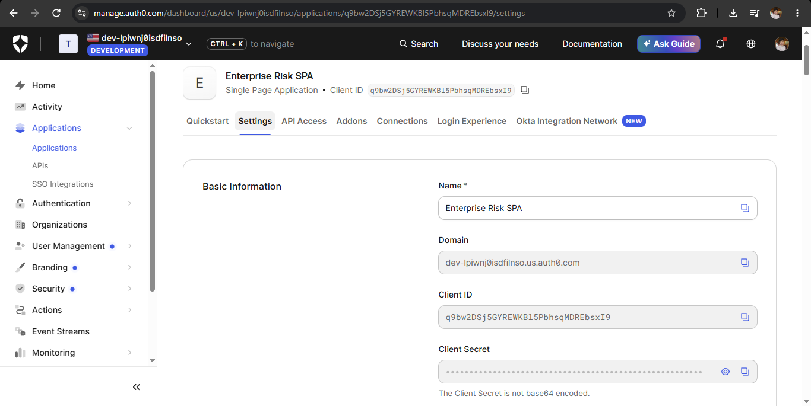
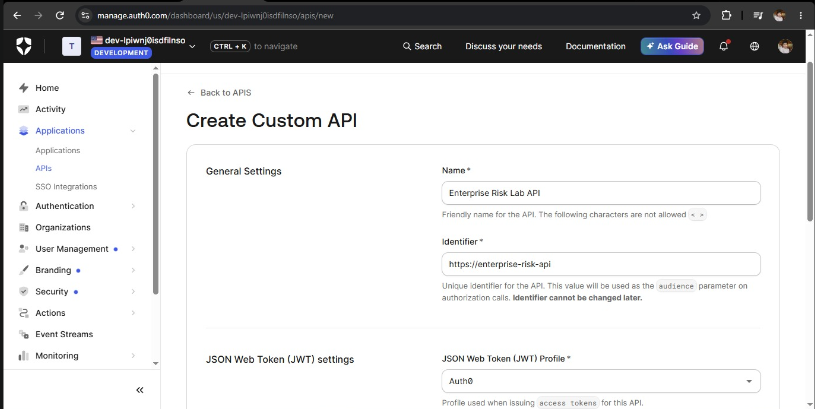
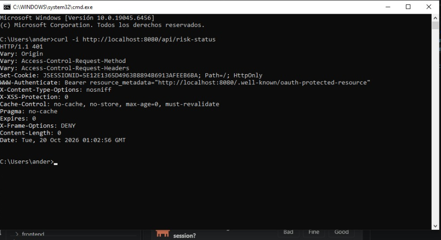
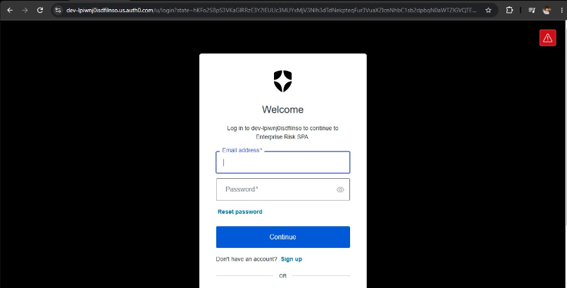
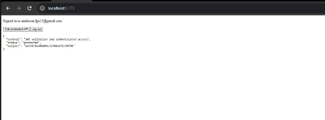
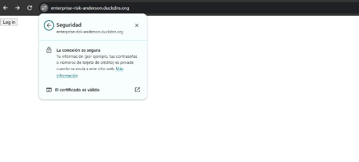
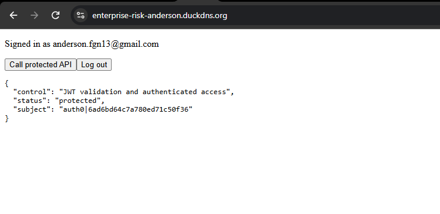
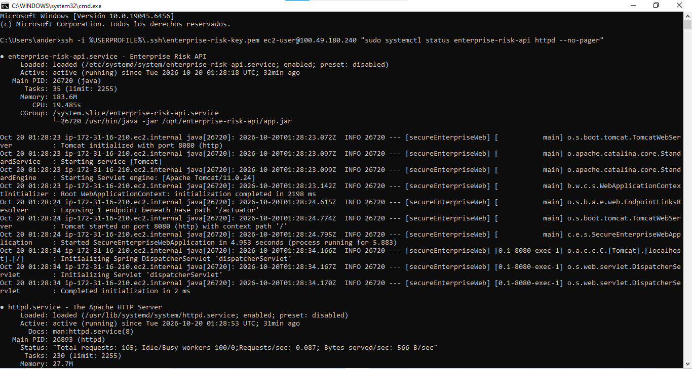

# Secure Web System as an Enterprise Risk Control

- **Deployed URL:** https://enterprise-risk-anderson.duckdns.org
- `backend/` — Spring Boot 4 / Java 21 backend (OAuth2 Resource Server, validates Auth0 JWT issuer + audience).
- `frontend/` — Vite React SPA using `@auth0/auth0-react`.
- `deploy/` — systemd unit and Apache vhost templates.

## Run locally
1. Set `issuer-uri` in `backend/src/main/resources/application.properties` and the CORS origin in `SecurityConfig.java`.
2. `cd backend && mvn spring-boot:run` — `GET /api/risk-status` without a token returns 401.
3. `cd frontend && cp .env.example .env.local` (fill in values, never commit it), `npm install && npm run dev` → http://localhost:5173.

## Evidence
Details of each screenshot: [docs/README.md](docs/README.md).

| Evidence | Screenshot |
|---|---|
| Auth0 SPA application |  |
| Auth0 API |  |
| API rejects requests without a token (401) |  |
| Auth0 login |  |
| Authenticated API call |  |
| Valid TLS certificate |  |
| Deployed application |  |
| Services running on the server |  |
